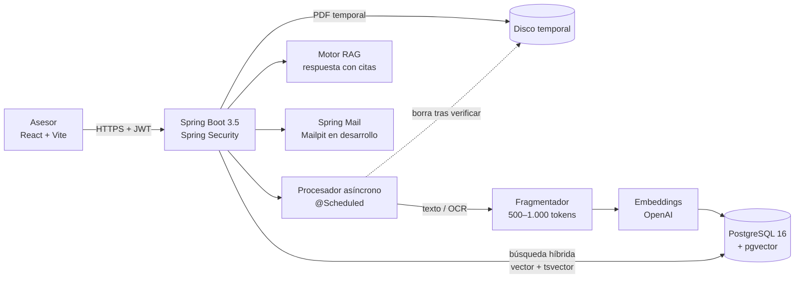

# Predia

**Asistente con IA para inmobiliarias en Colombia.** Proyecto del curso Inteligencia Artificial 2 de Campuslands.

Predia ayuda a una inmobiliaria (en la demo, *Altos Inmobiliaria*, de Bucaramanga) a:

1. **Consultar sus expedientes** (contratos, escrituras, certificados) con RAG, sin conservar el PDF original en el servidor.
2. **Conocer su inventario** de inmuebles disponibles.
3. **Calcular el presupuesto** de un cliente comprador.
4. **Simular el crédito hipotecario.**
5. **Controlar los documentos del vendedor** para el cierre del negocio y recordárselos.

Un asistente conversacional usa todo lo anterior como herramientas.

> **Principio de diseño: la IA sugiere, las reglas deciden y la persona confirma.**
> Los números (cuota, presupuesto, vigencias, faltantes) se calculan en Java con pruebas, nunca en el texto del modelo. Nada se envía a un cliente sin la aprobación del asesor.

> ⚠️ Todos los datos de la demo son **ficticios**: inmobiliaria, personas, inmuebles, documentos y tasas de crédito (marcadas como "tasa de ejemplo").

---

## Estado del proyecto

| Fase | Módulo | Estado |
|---|---|---|
| 1 | Esqueleto, autenticación JWT, multi-inmobiliaria, datos semilla | ✅ Listo |
| 2 | Indexación asíncrona de PDF (PDFBox, OCR, fragmentos, embeddings) | ✅ Listo |
| 3 | Consulta RAG híbrida con citas | ✅ Listo |
| 4 | Inventario, presupuesto y simulador de crédito | ✅ Listo |
| 5 | Cierre del negocio: documentos del vendedor y recordatorios | ⏳ Pendiente |
| 6 | Asistente con herramientas | ⏳ Pendiente |

El detalle de cada fase y cómo probarla está en [PROGRESO.md](PROGRESO.md). El diseño (modelo de datos, endpoints y reglas) está en [docs/DISENO.md](docs/DISENO.md).

---

## Arquitectura



- **Multi-inmobiliaria:** cada tabla de negocio lleva `inmobiliaria_id`. La inmobiliaria sale **siempre** del JWT del usuario, nunca de un parámetro de la petición. Un id que pertenece a otra inmobiliaria responde 404, igual que si no existiera.
- **Sin PDF en el servidor:** el archivo se guarda solo mientras se indexa. Después queda únicamente su hash SHA-256, los fragmentos de texto, los vectores y los metadatos.
- **Búsqueda vectorial con SQL explícito** (`JdbcTemplate`), para garantizar el filtro por inmobiliaria y permisos en cada consulta.
- **Modo manual:** sin API key de OpenAI, Predia arranca igual y muestra un aviso. En ese modo funciona con formularios, búsqueda por texto y plantillas.

### Tecnologías

Java 21 · Spring Boot 3.5 · Spring AI 1.1 (OpenAI) · Spring Security (JWT) · Spring Data JPA · Flyway · PostgreSQL 16 + pgvector · Apache PDFBox · Tesseract (tess4j) · springdoc-openapi · React 19 + Vite + TypeScript + Tailwind CSS 4 · Testcontainers

---

## Requisitos (macOS)

```bash
brew install openjdk@21 tesseract tesseract-lang   # tesseract-lang trae el idioma español (spa)
```

Además necesitas **Docker Desktop** (para PostgreSQL y Mailpit, y para las pruebas) y **Node.js 20.19 o superior**.

Java 21 se instala como *keg-only*; apunta `JAVA_HOME` a él:

```bash
export JAVA_HOME=$(brew --prefix openjdk@21)/libexec/openjdk.jdk/Contents/Home
```

## Cómo levantar el proyecto

1. **Variables de entorno.** Copia el ejemplo y genera un secreto para el JWT:
   ```bash
   cp .env.example .env
   ```
   ```bash
   openssl rand -base64 48
   ```
   Pega el resultado en `JWT_SECRET`. Si tienes una clave de OpenAI, ponla en `OPENAI_API_KEY`; si la dejas vacía, Predia funciona en modo manual.

2. **Base de datos y correo:**
   ```bash
   docker compose up -d
   ```
   PostgreSQL queda en `localhost:5434` y Mailpit en <http://localhost:8026>.

3. **Backend.** Flyway aplica las migraciones y se siembran los datos de la demo:
   ```bash
   ./mvnw spring-boot:run
   ```
   La API queda en <http://localhost:8080> y la documentación en <http://localhost:8080/swagger-ui.html>.

4. **Frontend:**
   ```bash
   cd frontend && npm install && npm run dev
   ```
   Abre <http://localhost:5173>.

### Usuarios de la demo

| Usuario | Rol | Contraseña |
|---|---|---|
| `admin@altos.test` | ADMIN | el valor de `DEMO_PASSWORD` en tu `.env` |
| `laura@altos.test` | ASESOR | el valor de `DEMO_PASSWORD` en tu `.env` |

### Variables de entorno

| Variable | Para qué sirve | Por defecto |
|---|---|---|
| `DB_HOST`, `DB_PORT`, `DB_NAME`, `DB_USER`, `DB_PASSWORD` | Conexión a PostgreSQL | `localhost`, `5434`, `predia`… |
| `JWT_SECRET` | Firma de los tokens (mínimo 32 caracteres) | **obligatoria** |
| `JWT_HORAS_VALIDEZ` | Duración de la sesión | `8` |
| `OPENAI_API_KEY` | Clave de OpenAI; vacía = modo manual | vacía |
| `OPENAI_CHAT_MODEL` | Modelo de chat | `gpt-5.4-mini` |
| `OPENAI_EMBEDDING_MODEL` | Modelo de embeddings (1536 dimensiones) | `text-embedding-3-small` |
| `MAIL_HOST`, `MAIL_PORT`, `MAILPIT_UI_PORT` | SMTP de desarrollo (Mailpit) | `localhost`, `1026`, `8026` |
| `DEMO_HABILITADA`, `DEMO_PASSWORD` | Siembra de los datos ficticios | `true`, — |

## Pruebas

```bash
./mvnw test
```

Las pruebas usan un PostgreSQL con pgvector real en un contenedor desechable (Testcontainers), así que Docker debe estar abierto. **Nunca llaman a OpenAI.**

---

## Módulos

| Módulo | Qué hace |
|---|---|
| Expedientes (RAG) | Sube un PDF, lo indexa de forma asíncrona y responde preguntas citando documento, página y sección. *(Fases 2–3)* |
| Inventario de inmuebles | Filtra con SQL lo no negociable y ordena por similitud con lo que pidió el cliente. *(Fase 4)* |
| Presupuesto del cliente | Calcula la cuota máxima y el tope de compra con reglas configurables por inmobiliaria. *(Fase 4)* |
| Simulador de crédito | Cuota fija (sistema francés) con tasas por banco cargadas por el ADMIN. *(Fase 4)* |
| Checklist de documentos para el cierre | Muestra qué le falta al vendedor y qué está por vencer, con semáforo y recordatorios aprobados por el asesor. *(Fase 5)* |
| Asistente con herramientas | Chat que usa los módulos anteriores con tool calling. *(Fase 6)* |

## Limitaciones conocidas

- **No se conserva el PDF original.** Predia no puede mostrar ni verificar firmas, sellos, imágenes o tablas complejas del original. Si cambia la extracción o el OCR, hay que volver a subir el archivo; los embeddings, en cambio, se pueden regenerar desde el texto guardado.
- **Dependencia del OCR:** la calidad de las páginas escaneadas depende de Tesseract y de la nitidez del documento.
- Las vigencias de los documentos dependen de la fecha de expedición que confirma el asesor.
- No hay antivirus: se valida el tipo, la estructura y el tamaño del archivo.
- La columna de vectores es de 1536 dimensiones. Cambiar a un proveedor de embeddings con otra dimensión exige una migración y reindexar.
- La lista de documentos para el cierre es de referencia. **Predia no da asesoría legal**: confirma los requisitos con la notaría.
- Las tasas de crédito son de ejemplo; la simulación no es una aprobación del banco.

## Créditos

Proyecto desarrollado por **Sebastián Acelas** — Inteligencia Artificial 2, Campuslands.
