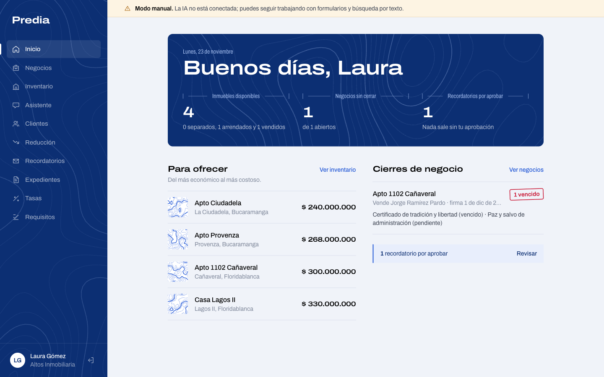
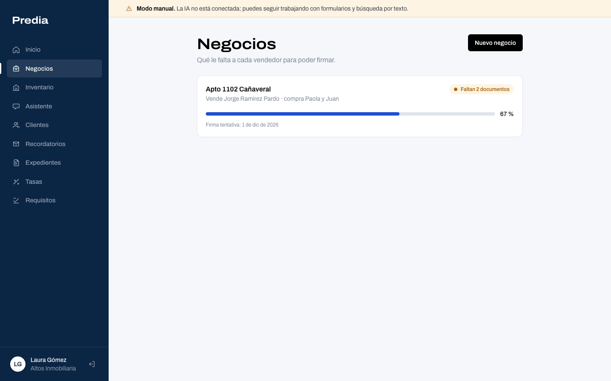
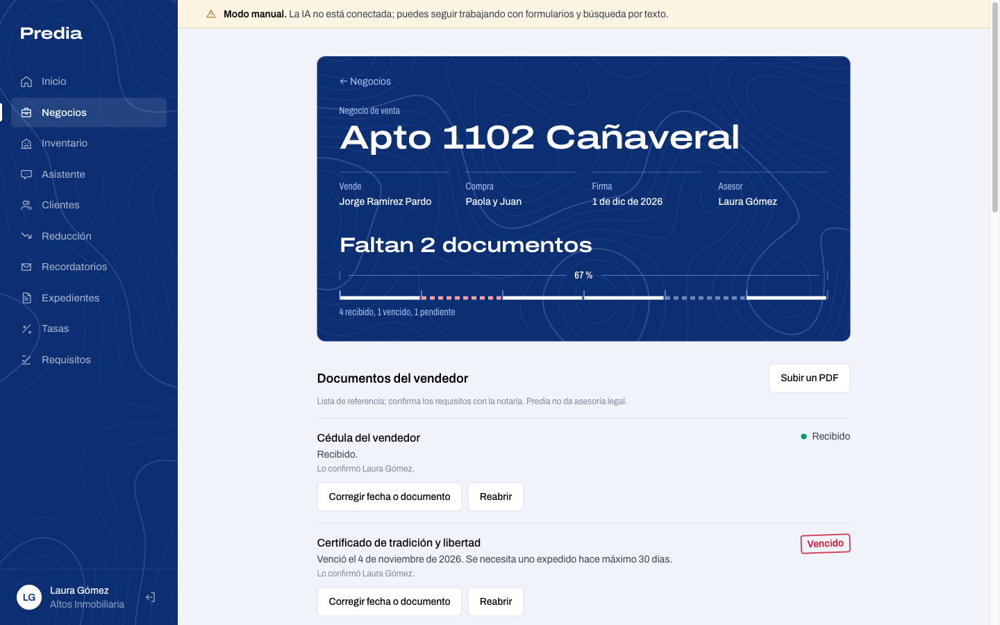
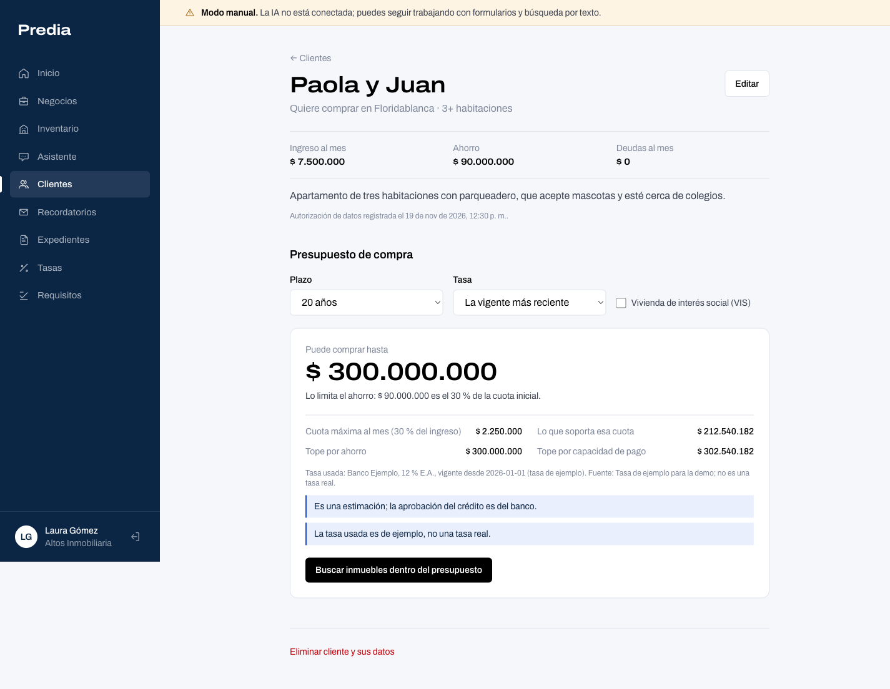
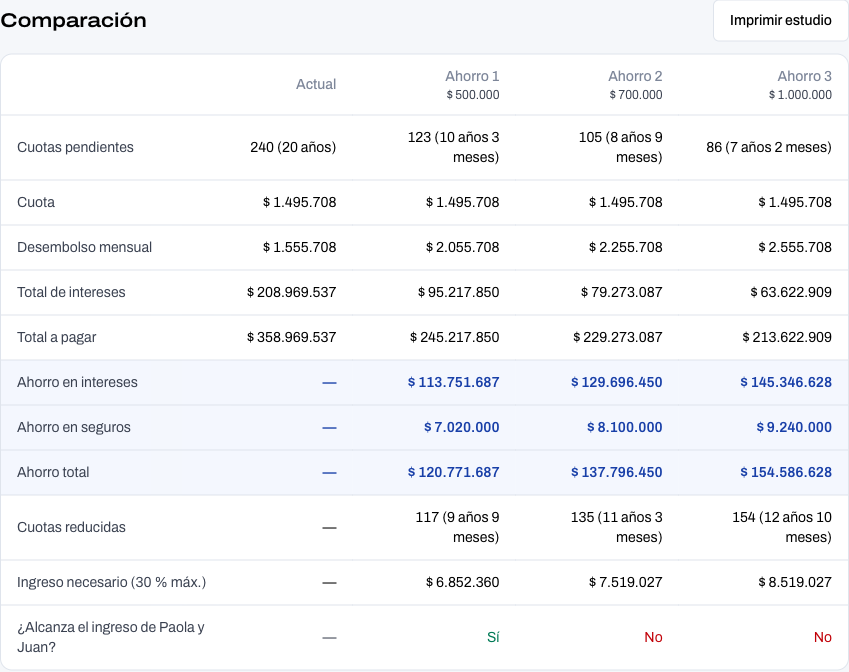
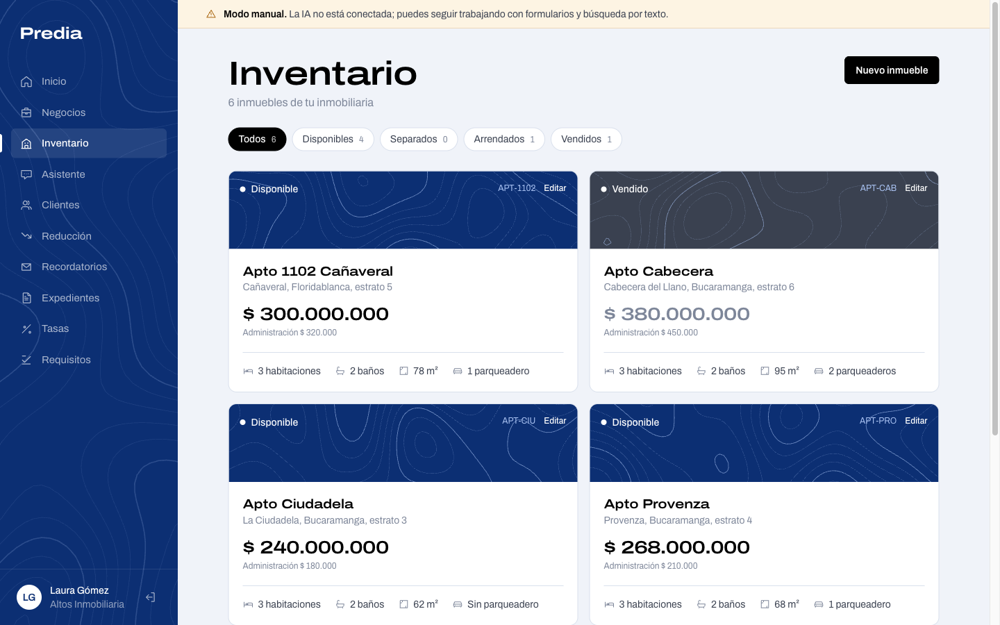
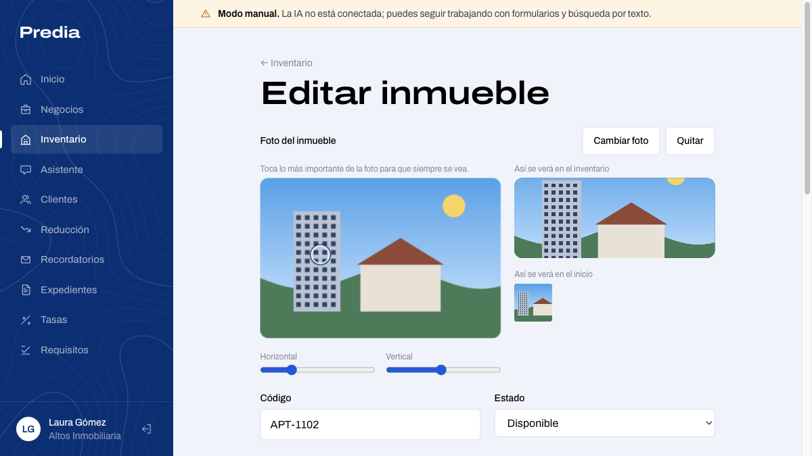
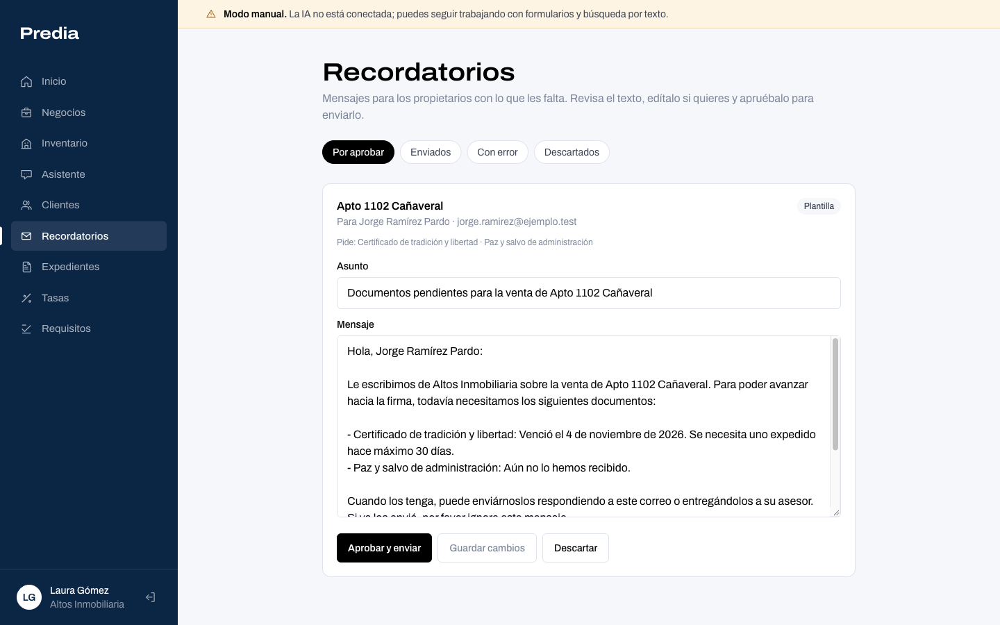
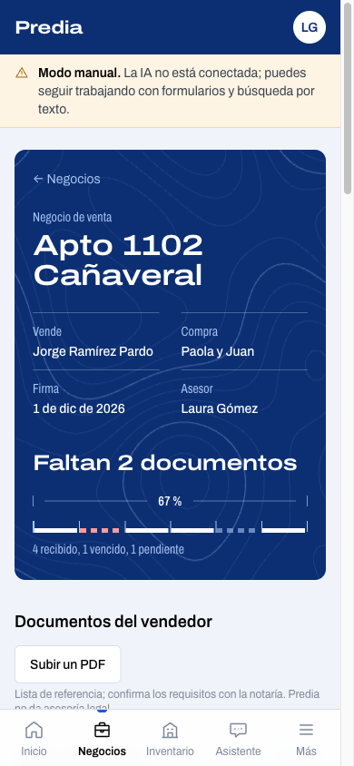
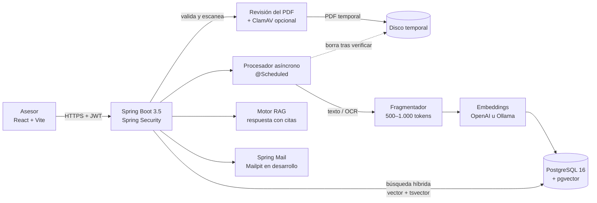

# Predia

**Asistente con IA para inmobiliarias en Colombia.** Proyecto del curso Inteligencia Artificial 2 de Campuslands.

Predia ayuda a una inmobiliaria (en la demo, *Altos Inmobiliaria*, de Bucaramanga) a:

1. **Consultar sus expedientes** (contratos, escrituras, certificados) con RAG, sin conservar el PDF original en el servidor.
2. **Conocer su inventario** de inmuebles disponibles.
3. **Calcular el presupuesto** de un cliente comprador.
4. **Simular el crédito hipotecario.**
5. **Controlar los documentos del vendedor** para el cierre del negocio y recordárselos.

Un asistente conversacional usa todo lo anterior como herramientas.

> **Principio de diseño: la IA sugiere, las reglas deciden y la persona confirma.**
> Los números (cuota, presupuesto, vigencias, faltantes) se calculan en Java con pruebas, nunca en el texto del modelo. Nada se envía a un cliente sin la aprobación del asesor.

> ⚠️ Todos los datos de la demo son **ficticios**: inmobiliaria, personas, inmuebles, documentos y tasas de crédito (marcadas como "tasa de ejemplo").

---

## Estado del proyecto

| Fase | Módulo | Estado |
|---|---|---|
| 1 | Esqueleto, autenticación JWT, multi-inmobiliaria, datos semilla | ✅ Listo |
| 2 | Indexación asíncrona de PDF (PDFBox, OCR, fragmentos, embeddings) | ✅ Listo |
| 3 | Consulta RAG híbrida con citas | ✅ Listo |
| 4 | Inventario, presupuesto y simulador de crédito | ✅ Listo |
| 5 | Cierre del negocio: documentos del vendedor y recordatorios | ✅ Listo |
| 6 | Asistente con herramientas (tool calling) | ✅ Listo |
| 7 | Pulido, guion de demo y pruebas finales | ✅ Listo |
| 8 | Usuarios, invitaciones y portal del propietario | ✅ Listo |
| 9 | Portal del comprador: inmuebles compartidos y simulador de compra | ✅ Listo |
| Extra | Reducción de crédito con abonos extraordinarios (Ley 546 de 1999) | ✅ Listo |
| Extra | Escaneo de archivos: revisión del PDF y antivirus ClamAV opcional | ✅ Listo |

El detalle de cada fase y cómo probarla está en [PROGRESO.md](PROGRESO.md). El diseño (modelo de datos, endpoints y reglas) está en [docs/DISENO.md](docs/DISENO.md).

---

## Capturas

Capturas de la demo con los datos ficticios de Altos Inmobiliaria (sin `OPENAI_API_KEY`, por eso se ve el aviso de modo manual). La identidad visual parte de los mapas topográficos: azul de plano, curvas de nivel generadas y cifras «acotadas», con su medida y la regla de la que salen.

| | |
|---|---|
|  **Ingreso:** las curvas de nivel se trazan al entrar. |  **Inicio:** lo del día en tres cifras acotadas. |
|  **Negocios:** cada cierre con su cota de avance. |  **Cierre del Apto 1102:** un tramo por documento; lo vencido, en rojo. |
|  **Presupuesto de Paola y Juan:** el tope de compra, con la regla que lo decidió. |  **Reducción de crédito:** tres abonos comparados contra el crédito actual. |
|  **Inventario:** la foto de cada inmueble (aquí, ilustraciones de ejemplo) o, sin foto, su propio terreno. |  **Subir la foto:** se toca lo importante y se ve cómo quedará en el inventario y en el inicio. |
|  **Recordatorios:** borrador para el propietario; solo sale si el asesor lo aprueba. | |

También se usa desde el celular (el asesor la abre en las visitas):



---

## Arquitectura



- **Multi-inmobiliaria:** cada tabla de negocio lleva `inmobiliaria_id`. La inmobiliaria sale **siempre** del JWT del usuario, nunca de un parámetro de la petición. Un id que pertenece a otra inmobiliaria responde 404, igual que si no existiera.
- **Sin PDF en el servidor:** el archivo se guarda solo mientras se indexa. Después queda únicamente su hash SHA-256, los fragmentos de texto, los vectores y los metadatos.
- **Búsqueda vectorial con SQL explícito** (`JdbcTemplate`), para garantizar el filtro por inmobiliaria y permisos en cada consulta.
- **Modo manual:** sin API key de OpenAI, Predia arranca igual y muestra un aviso. En ese modo funciona con formularios, búsqueda por texto y plantillas.

### Tecnologías

Java 21 · Spring Boot 3.5 · Spring AI 1.1 (OpenAI) · Spring Security (JWT) · Spring Data JPA · Flyway · PostgreSQL 16 + pgvector · Apache PDFBox · Tesseract (tess4j) · springdoc-openapi · React 19 + Vite + TypeScript + Tailwind CSS 4 · Testcontainers

---

## Requisitos (macOS)

```bash
brew install openjdk@21 tesseract tesseract-lang   # tesseract-lang trae el idioma español (spa)
```

Además necesitas **Docker Desktop** (para PostgreSQL y Mailpit, y para las pruebas) y **Node.js 20.19 o superior**.

Java 21 se instala como *keg-only*; apunta `JAVA_HOME` a él:

```bash
export JAVA_HOME=$(brew --prefix openjdk@21)/libexec/openjdk.jdk/Contents/Home
```

## Cómo levantar el proyecto

1. **Variables de entorno.** Copia el ejemplo y genera un secreto para el JWT:
   ```bash
   cp .env.example .env
   ```
   ```bash
   openssl rand -base64 48
   ```
   Pega el resultado en `JWT_SECRET`. Si tienes una clave de OpenAI, ponla en `OPENAI_API_KEY`; si la dejas vacía, Predia funciona en modo manual.

2. **Base de datos y correo:**
   ```bash
   docker compose up -d
   ```
   PostgreSQL queda en `localhost:5434` y Mailpit en <http://localhost:8026>.

3. **Backend.** Flyway aplica las migraciones y se siembran los datos de la demo:
   ```bash
   ./mvnw spring-boot:run
   ```
   La API queda en <http://localhost:8080> (no tiene página principal: la aplicación es la del puerto 5173) y la documentación interactiva en <http://localhost:8080/swagger-ui.html>. Para probar los endpoints protegidos: en `POST /api/auth/login` entra con un usuario, copia el `token` de la respuesta, pulsa **Authorize** (arriba a la derecha) y pégalo sin la palabra «Bearer»; cada prueba sale con los permisos de ese rol.

4. **Frontend:**
   ```bash
   cd frontend && npm install && npm run dev
   ```
   Abre <http://localhost:5173>.

### Atajo: un solo comando

Con Docker Desktop abierto y el `.env` listo, el script levanta PostgreSQL, Mailpit, el backend y el frontend, espera a que respondan y muestra las direcciones. `Ctrl+C` apaga el backend y el frontend; con `--docker-off` también detiene PostgreSQL y Mailpit. Los registros quedan en `logs/`.

```bash
./arrancar.sh
```

### Roles

| Rol | Quién es | Qué puede hacer |
|---|---|---|
| ADMIN | Personal de la inmobiliaria | Todo, y además: usuarios, tasas, parámetros, catálogo de requisitos y regenerar vectores |
| ASESOR | Personal de la inmobiliaria | El trabajo diario, e invitar al propietario y al comprador a su portal |
| PROPIETARIO | El vendedor de un inmueble | Solo su portal (`/portal`): su venta, sus documentos y los recordatorios que se le enviaron |
| COMPRADOR | Un cliente que quiere comprar | Solo su portal (`/comprador`): su presupuesto, los inmuebles que el asesor le compartió y el simulador de compra |

Nadie se registra solo: se entra por invitación. Desactivar a alguien cierra su sesión al instante.

### Usuarios de la demo

| Usuario | Rol | Contraseña |
|---|---|---|
| `admin@altos.test` | ADMIN | el valor de `DEMO_PASSWORD` en tu `.env` |
| `laura@altos.test` | ASESOR | el valor de `DEMO_PASSWORD` en tu `.env` |

### Variables de entorno

| Variable | Para qué sirve | Por defecto |
|---|---|---|
| `DB_HOST`, `DB_PORT`, `DB_NAME`, `DB_USER`, `DB_PASSWORD` | Conexión a PostgreSQL | `localhost`, `5434`, `predia`… |
| `JWT_SECRET` | Firma de los tokens (mínimo 32 caracteres) | **obligatoria** |
| `JWT_HORAS_VALIDEZ` | Duración de la sesión | `8` |
| `PREDIA_IA_PROVEEDOR` | Proveedor de IA: `openai` u `ollama` (modelos locales, ver «IA local con Ollama») | `openai` |
| `OLLAMA_URL`, `OLLAMA_CHAT_MODEL`, `OLLAMA_EMBEDDING_MODEL`, `OLLAMA_PENSAR` | Servidor, modelos y modo de pensar de Ollama (solo con `ollama`) | `http://localhost:11434`, `qwen3:8b`, `bge-m3`, `false` |
| `OPENAI_API_KEY` | Clave de OpenAI; vacía = modo manual | vacía |
| `OPENAI_CHAT_MODEL` | Modelo de chat | `gpt-5.4-mini` |
| `OPENAI_EMBEDDING_MODEL` | Modelo de embeddings (1536 dimensiones) | `text-embedding-3-small` |
| `ESCANEO_MODO` | Antivirus de los PDF: `DESACTIVADO` o `CLAMAV` (ver «Escaneo de archivos») | `DESACTIVADO` |
| `CLAMAV_HOST`, `CLAMAV_PUERTO` | Dónde escucha ClamAV (`clamd`) | `localhost`, `3310` |
| `ESCANEO_OBLIGATORIO` | Con `CLAMAV`, si el antivirus no responde el archivo se rechaza (503) en vez de aceptarse sin verificar | `true` |
| `MAIL_HOST`, `MAIL_PORT`, `MAILPIT_UI_PORT` | SMTP de desarrollo (Mailpit) | `localhost`, `1026`, `8026` |
| `DEMO_HABILITADA`, `DEMO_PASSWORD` | Siembra de los datos ficticios | `true`, — |
| `PREDIA_URL_PUBLICA` | Dirección de la interfaz, para los enlaces de invitación | `http://localhost:5173` |
| `PREDIA_ADMIN_EMAIL`, `PREDIA_ADMIN_NOMBRE`, `PREDIA_INMOBILIARIA_NOMBRE`, `PREDIA_INMOBILIARIA_NIT` | Primer administrador de una instalación nueva (ver [DESPLIEGUE.md](docs/DESPLIEGUE.md)) | vacías |

### Escaneo de archivos

Todo PDF que sube un asesor o un propietario pasa por dos revisiones antes de guardarse, y si alguna lo rechaza no queda nada: ni el documento, ni el trabajo de indexación, ni el archivo temporal.

1. **Revisión del PDF (siempre activa).** Debe empezar con la firma `%PDF-` (no basta con la extensión) y no puede traer JavaScript, acciones que abren otros programas ni archivos incrustados. Se recorren todos los objetos del documento con PDFBox, incluidos los que van comprimidos. Un contrato o un certificado legítimos no llevan nada de eso.
2. **Antivirus ClamAV (opcional).** Cada archivo se envía al servicio `clamd` antes de abrirlo. Por defecto está apagado para que Predia arranque con solo PostgreSQL; para activarlo:
   ```bash
   docker compose --profile escaneo up -d clamav
   ```
   Espera a que el contenedor esté `healthy` (la primera vez tarda unos minutos en cargar las firmas) y arranca la API con `ESCANEO_MODO=CLAMAV`. Con `ESCANEO_OBLIGATORIO=true` (por defecto), si ClamAV no responde el archivo se rechaza con 503 en vez de darlo por limpio.

Cuando algo se rechaza, el usuario ve que fue «por seguridad» y, si es la revisión del PDF, el motivo; el nombre de la amenaza solo queda en el registro del servidor, junto con el hash del archivo y nunca con su contenido ni datos del cliente.

## Producción y HTTPS

Predia no termina TLS: en producción va detrás de un proxy inverso con certificado (por ejemplo Caddy, que lo obtiene y renueva solo) que cifra el envío de los PDF y de la sesión. La guía paso a paso, con el `Caddyfile`, está en [docs/DESPLIEGUE.md](docs/DESPLIEGUE.md). La guía no se ha probado en un servidor real. En desarrollo todo va por `http://localhost`.

## Pruebas

```bash
./mvnw test
```

Las pruebas usan un PostgreSQL con pgvector real en un contenedor desechable (Testcontainers), así que Docker debe estar abierto. **Nunca llaman a OpenAI.**

---

## Módulos

| Módulo | Qué hace |
|---|---|
| Expedientes (RAG) | Sube un PDF, lo indexa de forma asíncrona y responde preguntas citando documento, página y sección. *(Fases 2–3)* |
| Inventario de inmuebles | Filtra con SQL lo no negociable y ordena por similitud con lo que pidió el cliente. Cada inmueble tiene una **galería de hasta 12 fotos y planos**: se suben en cualquier formato y tamaño, se reducen, el asesor las ordena (la primera foto es la portada) y elige qué parte de cada foto debe quedar visible al recortarla. *(Fase 4 y extra)* |
| Presupuesto del cliente | Calcula la cuota máxima y el tope de compra con reglas configurables por inmobiliaria. *(Fase 4)* |
| Simulador de crédito | Cuota fija (sistema francés) con tasas por banco cargadas por el ADMIN. *(Fase 4)* |
| Reducción de crédito | Para un cliente que ya tiene crédito hipotecario: compara hasta tres abonos extraordinarios (mensual, anual o único) que reducen el plazo o la cuota, con el ahorro en intereses y seguros, la tabla de amortización y un estudio imprimible. Basado en el simulador del autor, reescrito en Java con pruebas. *(Extra)* |
| Checklist de documentos para el cierre | Muestra qué le falta al vendedor y qué está por vencer, con semáforo y recordatorios aprobados por el asesor. *(Fase 5)* |
| Asistente con herramientas | Chat que elige entre siete herramientas (expedientes, inventario, presupuesto, crédito, reducción de crédito, estado del negocio y borrador de recordatorio) con tool calling. Las cifras salen de Java, el tenant del usuario autenticado y los recordatorios solo quedan como borrador. *(Fase 6)* |
| Usuarios y portal del propietario | El ADMIN crea al personal y el asesor invita al propietario que vende. Cada persona recibe un enlace de un solo uso (72 h) para crear su contraseña y después entra cuando quiera. El propietario solo ve **su portal**: cuánto le falta para firmar, qué documentos vencieron, cómo conseguirlos, y puede enviarlos; lo que envía queda en revisión hasta que el asesor lo confirma. *(Fase 8)* |
| Portal del comprador | El asesor invita a un cliente y decide qué inmuebles le comparte (sin dirección exacta, código ni datos del propietario). El comprador ve su tope de compra con la razón de cada cifra, las fotos y los planos de cada inmueble en un carrusel, **simula su compra** moviendo la cuota inicial y el plazo (las cifras las calcula el servidor), marca «me interesa» y le escribe al asesor, que ve esos mensajes en su inicio. *(Fase 9)* |

## Guion de demo

Para probar cada sección a fondo (qué hacer, qué deberías ver y qué explicar), y para consultar la base de datos, está la [guía de pruebas](docs/GUIA_DE_PRUEBAS.md). Este es el recorrido corto:

Recorrido de unos 8 minutos. Requiere `docker compose up -d`, `./mvnw spring-boot:run` y `npm run dev` (o `./arrancar.sh`, que levanta todo). Los pasos 2, 6, 7 y 8 usan IA: con OpenAI (`OPENAI_API_KEY`) o con modelos locales (`PREDIA_IA_PROVEEDOR=ollama`, ver «IA local con Ollama»). Sin IA, Predia sigue funcionando en modo manual: la búsqueda es por texto y el recordatorio sale de una plantilla. Entra como `laura@altos.test`.

**Antes de presentar (con Ollama):**

1. Docker abierto y `ollama serve` corriendo, con `qwen3:8b` y `bge-m3` descargados (`ollama list`).
2. `PREDIA_IA_PROVEEDOR=ollama ./arrancar.sh` (o la variable en el `.env`). `GET /api/sistema/estado` debe decir `"proveedor":"ollama"`.
3. Umbral de similitud en `0,35`: no tiene pantalla, se cambia con `PUT /api/parametros` (Swagger, como ADMIN, campo `umbralSimilitudRag`); `GET /api/parametros` lo muestra. Con el `0,30` de OpenAI, `bge-m3` deja pasar preguntas ajenas.
4. Calienta los modelos con una pregunta cualquiera: la primera tras arrancar tarda más (después, de 5 a 15 s por respuesta; Predia pide a Ollama que los mantenga cargados 2 horas).
5. Estado limpio: solo `contrato-demo.pdf` en el inmueble 1102, el borrador de recordatorio en la bandeja y Mailpit vacío (<http://localhost:8026>).

1. **Inicio.** Muestra el inventario del día y los inmuebles para ofrecer.
2. **Expedientes (RAG).** En *Expedientes* elige el *Apto 1102 Cañaveral*, sube `demo/pdfs/contrato-arrendamiento.pdf` y espera a que pase a «Indexado». Pregunta «¿el inmueble incluye parqueadero?»: la respuesta trae la cita (documento, página y sección; si el fragmento abarca varias cláusulas, el rango «primera — última»). Pregunta algo que el contrato no diga: responde que no tiene información, sin llamar al modelo. (El PDF de ejemplo es un contrato de arrendamiento ficticio.)
3. **Cliente y presupuesto.** Abre *Clientes → Paola y Juan*: cuota máxima y tope de compra (`$300.000.000`, limitado por el ahorro), con la tasa de ejemplo que se usó.
4. **Inmuebles para el cliente.** «Buscar inmuebles dentro del presupuesto»: aparece el Apto 1102 Cañaveral, en Floridablanca y dentro del tope.
5. **Simulador de crédito.** Simula el 1102 a 15 años: la cuota (`$2.438.073`) supera la cuota máxima y la pantalla lo advierte. En *Reducción*, para un crédito que el cliente ya tiene (por ejemplo `$150.000.000` al 11 % E.A. a 240 cuotas), compara abonos de `$500.000`, `$700.000` y `$1.000.000` al mes: con el primero se paga en 123 cuotas y se ahorran `$113.751.687` en intereses. «Imprimir estudio» genera el documento para el cliente.
6. **Cierre del negocio.** En *Negocios → Apto 1102 Cañaveral*: semáforo «Faltan 2 documentos» (certificado de tradición vencido y paz y salvo pendiente). Sube `demo/pdfs/paz-y-salvo-administracion.pdf` al negocio: con IA disponible lo reconoce y deja el requisito **SUGERIDO**; sin IA lo marcas tú. En ambos casos solo el asesor lo pasa a **RECIBIDO**.
7. **Recordatorio.** En *Recordatorios* hay un borrador para el propietario. Edítalo, apruébalo y míralo llegar en Mailpit (<http://localhost:8026>).
8. **Asistente.** Pregunta: «¿Qué le falta al dueño del apto 1102 de Cañaveral para firmar?», «¿Qué les alcanza a Paola y Juan en Floridablanca?» y «¿El apto 1102 incluye parqueadero?» (esta necesita el contrato del paso 2). Las cifras vienen de las herramientas; si el modelo escribe un número que ninguna herramienta entregó, la interfaz lo señala.

Los PDF de `demo/pdfs` son ficticios; se regeneran con `GeneradorPdfsDemo` (ver [PROGRESO.md](PROGRESO.md)). Si cambias algo en la demo, deja el negocio como estaba: reabre el requisito y limpia Mailpit.

## Limitaciones conocidas

- **Invitaciones por correo:** en desarrollo llegan a Mailpit; en producción hay que configurar un servidor SMTP real (no se probó con uno). Si el correo no sale, quien invita puede copiar el enlace y compartirlo por otro medio.
- **Las fotos y planos de los inmuebles sí se guardan** (a diferencia de los PDF): solo copias reducidas (fotos de 1600 píxeles y planos de 2000, más una miniatura de 480; JPEG) en PostgreSQL, sin metadatos ni el archivo original. Predia no administra derechos de imagen: sube fotos que la inmobiliaria pueda usar.
- **No se conserva el PDF original.** Predia no puede mostrar ni verificar firmas, sellos, imágenes o tablas complejas del original. Si cambia la extracción o el OCR, hay que volver a subir el archivo; los embeddings, en cambio, se pueden regenerar desde el texto guardado.
- **Dependencia del OCR:** la calidad de las páginas escaneadas depende de Tesseract y de la nitidez del documento.
- Las vigencias de los documentos dependen de la fecha de expedición que confirma el asesor.
- **Antivirus opcional:** viene apagado por defecto (se activa con ClamAV, ver «Escaneo de archivos»). ClamAV detecta lo que su base de firmas conoce, así que no sustituye las buenas prácticas del servidor; la revisión del PDF sí está siempre activa. La imagen de ClamAV pesa unos 560 MB y usa cerca de 1–2 GB de memoria.
- La columna de vectores es de 1536 dimensiones. Un modelo con menos (como `bge-m3`, de 1024) se rellena con ceros hasta 1536, lo que no cambia la similitud coseno; uno con más dimensiones se rechaza.
- **Cambiar de modelo de embeddings** (`OPENAI_EMBEDDING_MODEL`) no mezcla vectores: la búsqueda solo compara contra fragmentos indexados con el mismo modelo, y avisa cuántos quedaron fuera. Un ADMIN los regenera desde el texto guardado con `POST /api/documentos/regenerar-vectores` (por tandas de 300; se repite hasta que `pendientes` sea 0), sin volver a subir los PDF. Los inmuebles se recalculan solos en la siguiente búsqueda.
- La lista de documentos para el cierre es de referencia. **Predia no da asesoría legal**: confirma los requisitos con la notaría.
- Las tasas de crédito son de ejemplo; la simulación no es una aprobación del banco.
- **Reducción de crédito:** supone cuota fija, intereses calculados sobre el saldo de cada mes y el abono aplicado en la misma cuota, con cada valor redondeado al peso. Cada banco puede aplicar los abonos con pequeñas diferencias; el estudio es una estimación, no una oferta.
- **El asistente depende de la IA:** sin `OPENAI_API_KEY` queda deshabilitado (el resto de Predia funciona). Un modelo de lenguaje puede equivocarse al redactar: por eso las cifras salen de las herramientas y Predia señala cualquier número de la respuesta que ninguna herramienta haya entregado. Las conversaciones se guardan en memoria y se pierden al reiniciar el servidor.

### IA local con Ollama

Con `PREDIA_IA_PROVEEDOR=ollama` el chat, el asistente y los embeddings corren en tu equipo: los fragmentos de los documentos no viajan a ningún servicio externo y no hay costo por uso.

```bash
ollama pull qwen3:8b   # chat y herramientas del asistente (~5 GB)
ollama pull bge-m3     # embeddings multilingües (~1,2 GB)
ollama serve           # si no está corriendo ya
```

Luego, en el `.env`: `PREDIA_IA_PROVEEDOR=ollama`. `qwen3` «piensa» antes de responder, lo que multiplica el tiempo por cinco o más: Predia lo apaga por defecto (`OLLAMA_PENSAR=false`). Predia no descarga modelos por su cuenta. Al cambiar de proveedor, los vectores anteriores quedan fuera de la búsqueda hasta que un ADMIN los regenere con `POST /api/documentos/regenerar-vectores`. **Recalibra el umbral de similitud** (parámetro de la inmobiliaria) al cambiar de modelo: con `bge-m3`, 0,35–0,40 funcionó mejor que el 0,30 de OpenAI. Un modelo de 8 000 millones de parámetros puede equivocarse más que uno en la nube: las cifras siguen saliendo de Java, y el asistente señala cualquier número que ninguna herramienta haya entregado.

## Créditos

Proyecto desarrollado por **Sebastián Acelas** — Inteligencia Artificial 2, Campuslands.
