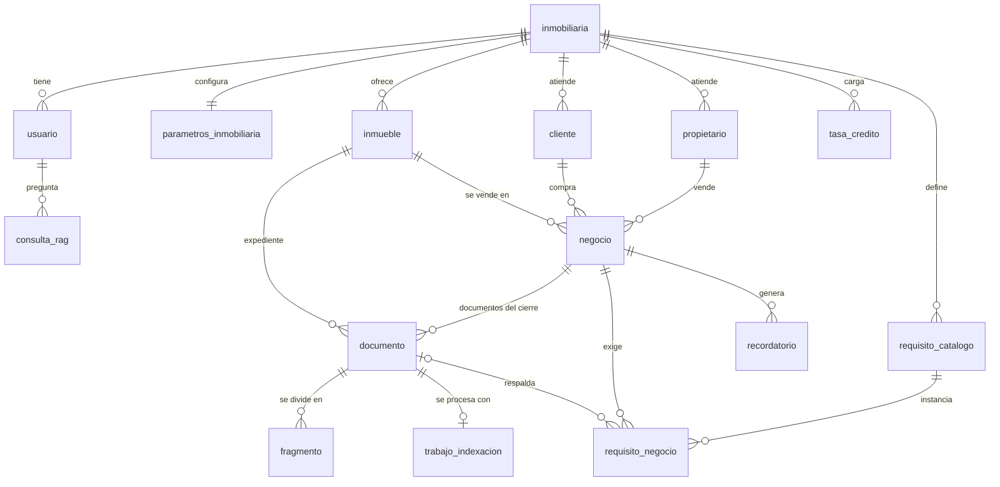

# Predia — Propuesta de diseño (v0, para revisión)

> Principio rector: **la IA sugiere, las reglas deciden y la persona confirma.**
> Este documento se revisa y aprueba antes de escribir código.

---

## 1. Versiones y dependencias

Verificadas en Maven Central el 19/11/2026.

| Pieza | Versión | Por qué |
|---|---|---|
| Java | 21 (LTS) | Pedido. En el Mac solo está Java 27 → instalar `openjdk@21` (ver §8). |
| Spring Boot | **3.5.16** | Última 3.x. Spring AI 2.x ya exige Boot 4, así que 3.5 es la última compatible con Spring AI 1.x. |
| Spring AI | **1.1.8** (BOM) | Última 1.x. Solo `spring-ai-starter-model-openai` (embeddings + chat + tool calling). |
| PostgreSQL | 16 + pgvector (`pgvector/pgvector:pg16`) | Pedido. |
| Flyway | la que gestiona Boot 3.5 + `flyway-database-postgresql` | Esquema versionado. |
| Apache PDFBox | 3.0.x | Extracción de texto y render de páginas para OCR. |
| tess4j | 5.x (con exclusiones de dependencias que no usamos) | OCR con Tesseract local, idioma `spa`. |
| springdoc-openapi | 2.8.x | La rama 2.x es la de Boot 3 (la 3.x es para Boot 4). |
| JWT | `spring-boot-starter-oauth2-resource-server` | Valida/firma JWT HMAC con Nimbus, que ya trae Spring Security. **Evita sumar jjwt.** |
| Tokens | jtokkit (ya llega como dependencia de Spring AI) | Contar tokens para fragmentar 500–1.000. Sin dependencia nueva. |
| Pruebas | JUnit 5, Mockito, **Testcontainers** (`pgvector/pgvector:pg16`) | Ver nota abajo. |

**Dependencias que pido aprobar explícitamente:**
- **Testcontainers** (solo `test`): las pruebas de aislamiento multi-inmobiliaria, búsqueda híbrida y borrado del PDF necesitan un PostgreSQL real con pgvector y `tsvector` en español; H2 no sirve. Levanta un contenedor desechable durante `./mvnw test` (requiere Docker abierto).
- **tess4j**: es la librería que pidió el profesor; trae JNA y algunas librerías de imagen. Excluyo las que no usamos (ghost4j, etc.).
- **No** uso el `PgVectorStore` de Spring AI: su esquema y sus filtros no garantizan `inmobiliaria_id` en el SQL. La búsqueda va con `JdbcTemplate` y SQL explícito (equivalente a *Pgvector.EntityFrameworkCore*).
- **No** uso Lombok (falla a menudo con JDK nuevos); uso `record` de Java 21.

---

## 2. Estructura de carpetas

Proyecto Maven en la raíz (para que `./mvnw spring-boot:run` funcione tal cual) y frontend en `/frontend`. Paquetes **por módulo**, no por capa.

```
predia/
├── pom.xml  mvnw  .mvn/
├── docker-compose.yml          # postgres-pgvector + mailpit
├── .env.example                # sin secretos reales
├── README.md  PROGRESO.md
├── docs/DISENO.md              # este documento
├── demo/pdfs/                  # PDF ficticios generados (contrato, escritura, reglamento, certificado escaneado)
├── src/main/java/co/predia/
│   ├── PrediaApplication.java
│   ├── comun/
│   │   ├── seguridad/          # SecurityConfig, JwtService, UsuarioActual (id, inmobiliariaId, rol)
│   │   ├── ia/                 # ProveedorEmbeddings (interfaz), OpenAiProveedorEmbeddings,
│   │   │                       # EstadoIa (¿hay API key?), SalidaEstructurada (JSON validado)
│   │   ├── web/                # manejo global de errores, DTO de error
│   │   └── demo/               # DatosDemo (perfil "demo"), GeneradorPdfsDemo
│   ├── inmobiliaria/           # Inmobiliaria, Usuario, ParametrosInmobiliaria
│   ├── auth/                   # login, /yo
│   ├── expedientes/
│   │   ├── carga/              # recepción, validación, archivo temporal, hash
│   │   ├── indexacion/         # TrabajoIndexacion, ProcesadorIndexacion (@Scheduled),
│   │   │                       # ExtractorPdf (PDFBox), ServicioOcr (tess4j), Fragmentador,
│   │   │                       # ClasificadorDocumento (IA → SUGERIDO)
│   │   └── consulta/           # BusquedaHibrida (JdbcTemplate), MotorRag, Citas
│   ├── inventario/             # Inmueble, BusquedaInmuebles (SQL filtra → pgvector ordena)
│   ├── clientes/               # Cliente, ExtractorPerfil (IA), CalculadoraPresupuesto (reglas)
│   ├── credito/                # TasaCredito, SimuladorCredito (sistema francés)
│   ├── cierre/
│   │   ├── catalogo/           # RequisitoCatalogo
│   │   ├── negocio/            # Negocio, Propietario, RequisitoNegocio
│   │   ├── reglas/             # MotorReglasCierre (estado efectivo, semáforo) ← corazón del módulo
│   │   ├── recordatorios/      # Recordatorio, RedactorRecordatorio (IA + validación + plantilla), job diario
│   │   └── resumen/            # ResumenDiarioAsesor
│   └── asistente/              # AsistenteService (tool calling), HerramientasPredia
├── src/main/resources/
│   ├── application.yml
│   ├── db/migration/           # V1__base.sql, V2__expedientes.sql, ... (una por fase)
│   └── prompts/                # plantillas de prompt en español (.st)
├── src/test/java/co/predia/... # unitarias (reglas, cálculos) + integración (Testcontainers)
└── frontend/                   # React + Vite + TS + Tailwind
    └── src/
        ├── api/                # cliente HTTP tipado, manejo del JWT
        ├── componentes/        # Semaforo, Cita, AvisoIa, BarraNavegacion (inferior en celular)
        └── paginas/            # Login, Inicio (resumen diario), Expedientes, Asistente,
                                # Inventario, Clientes, Credito, Negocios, Recordatorios, Admin
```

---

## 3. Modelo de datos

Todas las tablas de negocio llevan `inmobiliaria_id NOT NULL` con FK, y los índices empiezan por `inmobiliaria_id`. Montos en `NUMERIC(15,2)` (pesos) y tasas en `NUMERIC(9,6)`; en Java todo es `BigDecimal`.



### 3.1 Base (Fase 1)

**inmobiliaria** — `id, nombre, nit, ciudad, creada_en`

**usuario** — `id, inmobiliaria_id, nombre, email (único), password_hash (BCrypt), rol (ADMIN|ASESOR), activo`

**parametros_inmobiliaria** (una fila por inmobiliaria; la edita el ADMIN)
| campo | por defecto |
|---|---|
| `pct_cuota_max_ingreso` | 0.30 |
| `pct_cuota_inicial` / `pct_cuota_inicial_vis` | 0.30 / 0.20 |
| `plazo_default_anios` | 20 |
| `dias_alerta_vencimiento` (N de POR_VENCER) | 7 |
| `ciudades_con_valorizacion` (`text[]`) | `{}` → decide si aplica el paz y salvo de valorización |
| `umbral_similitud_rag` | 0.30 (ajustable tras pruebas con datos reales) |
| `email_remitente` | correo que firma los recordatorios |

### 3.2 Expedientes (Fases 2–3)

**documento**
- `id, inmobiliaria_id, inmueble_id, negocio_id NULL`
- `nombre_archivo, hash_sha256, tamano_bytes, paginas, paginas_ocr`
- `estado_indexacion` (EN_COLA | PROCESANDO | INDEXADO | ERROR), `error`, `indexado_en`
- `vectorizado BOOLEAN`: si no hubo IA se guardan fragmentos sin vector y se vectorizan después **desde el texto guardado, sin volver a pedir el PDF**
- Clasificación: `tipo_sugerido, fecha_expedicion_sugerida, confianza, hipoteca_vigente_sugerida NULL`, `clasificacion_estado` (SIN_CLASIFICAR | SUGERIDA | CONFIRMADA), `tipo_confirmado, fecha_expedicion_confirmada, confirmado_por, confirmado_en`
- `roles_permitidos text[]` (por defecto `{ADMIN,ASESOR}`), `subido_por, creado_en`
- `UNIQUE (inmobiliaria_id, hash_sha256)` para detectar duplicados
- **No hay columna para el PDF.**

**trabajo_indexacion** — `id, inmobiliaria_id, documento_id, ruta_temporal, estado (PENDIENTE|EN_CURSO|TERMINADO|FALLIDO), intentos, proximo_intento, error, creado_en, actualizado_en`. El procesador `@Scheduled` toma trabajos con `FOR UPDATE SKIP LOCKED`, así no hace falta un broker.

**fragmento**
- `id, inmobiliaria_id, documento_id, inmueble_id` (desnormalizado para filtrar rápido), `orden`
- `pagina_inicio, pagina_fin, seccion, texto, tokens, es_ocr`
- `embedding vector(1536) NULL, embedding_modelo`
- `roles_permitidos text[]` (copiado del documento)
- `tsv tsvector GENERATED ALWAYS AS (to_tsvector('spanish', coalesce(seccion,'') || ' ' || texto)) STORED`
- Índices: HNSW `vector_cosine_ops` en `embedding`, GIN en `tsv`, btree `(inmobiliaria_id, documento_id, orden)`

**consulta_rag** (trazabilidad) — `id, inmobiliaria_id, usuario_id, pregunta, respuesta, fragmentos_ids bigint[], sin_evidencia, modelo_chat, creado_en`

### 3.3 Inventario, clientes y crédito (Fase 4)

**inmueble**
- `id, inmobiliaria_id, codigo, titulo, tipo` (APARTAMENTO | CASA | LOCAL | OFICINA | LOTE)
- `direccion, barrio, ciudad, estrato, area_m2, habitaciones, banos, parqueaderos, acepta_mascotas, valor_administracion`
- `operacion` (VENTA | ARRIENDO), `precio_venta, canon_arriendo, es_vis, propiedad_horizontal`
- `descripcion, estado` (DISPONIBLE | SEPARADO | ARRENDADO | VENDIDO)
- `embedding vector(1536) NULL, embedding_modelo`: se regenera al crear o editar la descripción

**cliente**
- `id, inmobiliaria_id, nombre, email, telefono`
- `ingreso_familiar, ahorro, deudas_mensuales, intencion` (COMPRAR | ARRENDAR), `habitaciones_min, zonas text[], preferencias`
- `autorizacion_datos BOOLEAN NOT NULL CHECK (autorizacion_datos)`, `autorizacion_fecha, autorizacion_registrada_por`: **no se puede guardar sin autorización** (Ley 1581 de 2012)
- No se guarda el texto libre que pegó el asesor, solo el perfil confirmado.

**tasa_credito** — `id, inmobiliaria_id, banco, tipo (VIS|NO_VIS), tasa_ea, vigente_desde, fuente, fecha_carga, es_ejemplo, cargada_por`. La semilla es "Banco Ejemplo", 12 % E.A., `es_ejemplo = true`.

Las simulaciones no se guardan: el cálculo es determinista y se rehace al pedirlo.

### 3.4 Cierre del negocio (Fase 5)

**propietario** — `id, inmobiliaria_id, tipo_persona (NATURAL|JURIDICA), nombre, tipo_documento, numero_documento, email, telefono, estado_civil (SOLTERO|CASADO|UNION_MARITAL|DIVORCIADO|VIUDO), autorizacion_datos…`

**negocio** — `id, inmobiliaria_id, inmueble_id, propietario_id, cliente_comprador_id NULL, asesor_id, fecha_firma_tentativa, actua_por_apoderado, hipoteca_vigente (SI|NO|DESCONOCIDO), estado (ABIERTO|FIRMADO|CANCELADO), creado_en`. `hipoteca_vigente` lo confirma el asesor; la IA solo lo sugiere a partir del certificado de tradición.

**requisito_catalogo** (por inmobiliaria; se siembra con la lista base)
- `id, inmobiliaria_id, codigo, nombre, descripcion, orden, activo`
- `regla_aplica`: SIEMPRE | SI_VALORIZACION | SI_PROPIEDAD_HORIZONTAL | SI_HIPOTECA | SI_CASADO_O_UNION | SI_APODERADO | SI_PERSONA_JURIDICA
- `obligatorio` (`false` para "Recibos de servicios públicos", que es práctica recomendada y no bloquea el semáforo)
- `regla_vigencia`: NINGUNA | DIAS_DESDE_EXPEDICION | ANIO_EN_CURSO | MES_EN_CURSO, más `vigencia_dias`
- `tipo_documento`: une el requisito con la clasificación de la IA
- `palabras_clave text[]`: se usa para validar que el recordatorio no mencione documentos de más

Ejemplos: tradición → `DIAS_DESDE_EXPEDICION, 30`; predial → `ANIO_EN_CURSO`; administración → `SI_PROPIEDAD_HORIZONTAL + MES_EN_CURSO`; existencia y representación → `SI_PERSONA_JURIDICA + DIAS_DESDE_EXPEDICION, 30`.

**requisito_negocio** — `id, inmobiliaria_id, negocio_id, requisito_id, documento_id NULL, estado_registrado (PENDIENTE|SUGERIDO|RECIBIDO|NO_APLICA_MANUAL), fecha_expedicion, sugerido_en, recibido_por, recibido_en, nota`

**Separo el estado que registran las personas del estado efectivo.** En la tabla solo se guarda lo que hizo una persona (o la sugerencia de la IA). El estado que ve la interfaz (PENDIENTE, SUGERIDO, RECIBIDO, POR_VENCER, VENCIDO o NO_APLICA) lo calcula siempre `MotorReglasCierre`, una clase Java pura y probada, a partir de `(requisito, negocio, inmueble, propietario, estado_registrado, fecha_expedicion, hoy)`:
1. Si la regla de aplicación no se cumple, o el asesor lo marcó como no aplica → **NO_APLICA**.
2. Si no está RECIBIDO → **PENDIENTE** o **SUGERIDO** (la vigencia solo se evalúa sobre documentos confirmados).
3. Si está RECIBIDO, se calcula `vence_el` según la regla de vigencia:
   - `vence_el < hoy` → **VENCIDO**
   - `vence_el < fecha_firma` o `vence_el − hoy < N días` → **POR_VENCER**
   - si no → **RECIBIDO**

Semáforo: "Listo para firmar" si ningún requisito obligatorio que aplica está en PENDIENTE, SUGERIDO, VENCIDO o POR_VENCER. Si no, "Faltan X documentos", con el detalle. El avance es igual a recibidos ÷ obligatorios que aplican.

> Con "hoy" fijo, el caso de prueba "expedido hace 25 días con firma en 10 días" da `vence_el` = hoy + 5, que es anterior a la firma → POR_VENCER ✔. "Expedido hace 31 días" da VENCIDO ✔.

**recordatorio**
- `id, inmobiliaria_id, negocio_id, destinatario_email`
- `estado`: SUGERIDO | APROBADO | ENVIADO | DESCARTADO | ERROR_ENVIO
- `items jsonb`: la foto de lo que entregó el motor de reglas, que sirve como historial de "qué se pidió"
- `asunto, cuerpo_sugerido, cuerpo_final, origen_texto` (IA | PLANTILLA)
- `creado_en, editado_por, aprobado_por, aprobado_en, enviado_en, error`

La redacción sigue este flujo:
1. La IA recibe **solo** la lista de ítems.
2. Un validador en Java revisa que el texto no contenga palabras clave de requisitos que no están en la lista y que mencione todos los ítems.
3. Si la validación falla, o no hay IA, se usa una plantilla determinista.
4. El texto final que edita el asesor se valida otra vez. Si menciona algo de más, se le avisa pero no se le bloquea: el asesor decide.

Se envía **solo** a través de `POST /aprobar`; ningún job envía correos al cliente.

**Resumen diario del asesor**: se calcula al consultarlo (negocios bloqueados y documentos que vencen en los próximos 7 días). Opcional: un correo interno al asesor por Mailpit. Es interno, no va al cliente, así que no requiere aprobación.

### 3.5 Asistente (Fase 6)

Sin tablas nuevas: la memoria de la conversación va en `MessageWindowChatMemory` en memoria, por usuario y conversación. Las herramientas obtienen `inmobiliariaId` del usuario autenticado y **nunca de un parámetro que el modelo pueda inventar**. Los extras de IA 2 sumarían la tabla `visita` (`comentario`, `sentimiento_sugerido`).

---

## 4. Flujos clave

### Indexación

1. `POST /api/documentos` (multipart). Se valida:
   - tamaño ≤ 20 MB (configurable);
   - `Content-Type`, cabecera `%PDF-` y que PDFBox lo abra (se rechazan PDF cifrados).
2. Se calcula el SHA-256 y se guarda en un directorio temporal privado, con un nombre aleatorio.
3. Se crea `documento` (EN_COLA) y `trabajo_indexacion`, y se responde **202**.
4. El procesador marca el documento PROCESANDO y recorre las páginas: PDFBox extrae el texto y, si una página tiene menos de ~30 caracteres útiles, la renderiza a 300 DPI y le aplica OCR con tess4j en `spa`.
5. El `Fragmentador` detecta secciones con heurísticas (CLÁUSULA…, ARTÍCULO…, CAPÍTULO…, títulos en mayúsculas) y arma fragmentos de unos 800 tokens (mínimo 500 y máximo 1.000) con un solapamiento de unos 100 tokens. Conserva página de inicio y fin, sección y orden.
6. Se generan los embeddings por lotes con `ProveedorEmbeddings`.
7. La clasificación con IA usa los primeros fragmentos, nunca el PDF completo. La salida JSON se valida y queda SUGERIDA. Si el documento pertenece a un negocio, el requisito correspondiente pasa a SUGERIDO.
8. Se verifica que haya N fragmentos en la base y que su número coincida con lo generado. Después se **borra el temporal** y el documento queda INDEXADO.
   - Si falla, se reintenta hasta 3 veces. Al fallo definitivo se marca ERROR, también se borra el temporal y se pide volver a subir el archivo.
   - Un barrido al arrancar borra los temporales huérfanos.

### Consulta RAG

1. Se calcula el embedding de la pregunta con el modelo del índice (`WHERE embedding_modelo = :modelo`).
2. Se hacen dos consultas SQL, **ambas con `inmobiliaria_id = :tenant AND :rol = ANY(roles_permitidos)`** y el filtro opcional por inmueble:
   - vectorial: top 20 por `embedding <=> :q`;
   - textual: top 20 por `ts_rank(tsv, websearch_to_tsquery('spanish', :pregunta))`.
3. Se fusionan con **Reciprocal Rank Fusion** (k = 60), se reordenan y se eligen los 5 mejores (con un máximo de 2 por página, para variar la evidencia).
4. Si la mejor similitud es menor que el umbral **y** no hay coincidencia textual, la respuesta es "No tengo información suficiente…" y **no se llama al modelo**.
5. El modelo recibe los fragmentos numerados [1]…[5] con instrucciones de citar y de decir "no lo sé" si no encuentra la respuesta.
6. Las citas que se devuelven a la interfaz (documento, página y sección) salen de los metadatos, no del texto del modelo. Se descartan las referencias a números de fragmento que no existen.

### Sin API key o con la IA caída

`EstadoIa` lo detecta y la interfaz muestra un aviso. En ese caso:
- la indexación guarda los fragmentos con `vectorizado = false` y la búsqueda funciona solo con texto;
- la consulta devuelve los fragmentos encontrados sin respuesta redactada;
- la clasificación, el perfil del cliente y la búsqueda de inmuebles se hacen con formularios manuales o filtros SQL;
- el recordatorio usa la plantilla;
- el asistente queda deshabilitado con un aviso.

---

## 5. Endpoints principales

Todos van bajo `/api`, con JWT salvo el login. El tenant **siempre** sale del token. La documentación está en `/swagger-ui.html`.

| Módulo | Método y ruta | Rol | Nota |
|---|---|---|---|
| Auth | `POST /auth/login` → `{token}` · `GET /auth/yo` | — | |
| Sistema | `GET /sistema/estado` → `{iaDisponible, modeloChat, modeloEmbeddings}` | todos | Para el aviso de IA en la interfaz |
| Parámetros | `GET/PUT /parametros` | ADMIN (PUT) | |
| Documentos | `POST /documentos` (multipart: archivo, inmuebleId, negocioId?) → 202 | ADMIN, ASESOR | |
| | `GET /documentos?inmuebleId=&negocioId=` · `GET /documentos/{id}` | | Muestra el estado de indexación |
| | `PUT /documentos/{id}/clasificacion` | | El asesor confirma o corrige tipo y fecha |
| | `POST /documentos/{id}/reindexar` (multipart) | | Exige el mismo hash o lo actualiza |
| | `DELETE /documentos/{id}` | | Borra los fragmentos |
| Consultas | `POST /consultas` `{pregunta, inmuebleId?}` → `{respuesta, citas[], sinEvidencia}` | | |
| Inmuebles | CRUD `/inmuebles` | | |
| | `POST /inmuebles/busqueda` `{operacion, precioMax, habitacionesMin, ciudad?, descripcion}` → `[{inmueble, coincidenciaPct}]` | | Primero filtra SQL y después ordena pgvector |
| Clientes | `POST /clientes/extraer-perfil` `{texto}` → perfil SUGERIDO | | No guarda nada |
| | CRUD `/clientes` | | Rechaza el guardado sin autorización de datos |
| | `GET /clientes/{id}/presupuesto?plazoAnios=&tasaId=` | | |
| Crédito | CRUD `/tasas` | ADMIN (escritura) | |
| | `POST /creditos/simular` `{monto \| (inmuebleId, clienteId), plazoAnios, tasaId?/banco?}` | | |
| Catálogo | CRUD `/requisitos` | ADMIN | |
| Negocios | CRUD `/negocios` | | Al crearlo se instancian sus requisitos |
| | `GET /negocios/{id}/estado-documental` → semáforo, avance e ítems con estado efectivo | | |
| | `PUT /negocios/{id}/requisitos/{rid}` `{accion: RECIBIR\|NO_APLICA\|REABRIR, fechaExpedicion?, documentoId?}` | | Solo una persona pasa un requisito a RECIBIDO |
| Recordatorios | `GET /recordatorios?estado=SUGERIDO` (bandeja) · `GET /negocios/{id}/recordatorios` (historial) | | |
| | `POST /negocios/{id}/recordatorios` | | Genera un recordatorio SUGERIDO al momento |
| | `PUT /recordatorios/{id}` | | Editar |
| | `POST /recordatorios/{id}/aprobar` | | **Único camino de envío** |
| | `POST /recordatorios/{id}/descartar` | | |
| Resumen | `GET /resumen-diario` | | |
| Asistente | `POST /asistente/mensajes` `{conversacionId, mensaje}` → `{respuesta, herramientasUsadas[], citas[]}` | | |

---

## 6. Reglas de cálculo (Java, con pruebas)

- **Tasa mensual:** `i = (1 + EA)^(1/12) − 1`, calculada en `double` para la potencia y redondeada con `BigDecimal` a 10 decimales.
- **Cuota:** `P · i / (1 − (1 + i)^−n)`. Se redondea al peso solo al final (`HALF_UP`).
- **Presupuesto:**
  - cuota máxima = 30 % × ingreso;
  - monto que soporta la cuota = el valor presente de la cuota máxima con `i` y `n`;
  - tope = `min(ahorro ÷ %inicial, ahorro + monto soportado)`.

  Con los datos de Paola y Juan: 90 M ÷ 0,30 = **300 M** frente a 90 M + ~212,5 M = 302,5 M, así que el tope es de **300 M** ✔. La cuota de 210 M a 12 % E.A. a 240 meses da ≈ **$2.223.000** ✔.
- Las deudas mensuales se muestran como alerta (cuota + deudas > X % del ingreso), pero **no se restan** de la fórmula, para respetar la regla que pediste y la prueba de 2.250.000. Si quieres restarlas, sería un parámetro más.
- **VIS:** se usa `es_vis` del inmueble para elegir el 20 % de cuota inicial y el tipo de tasa.

---

## 7. Ramas (GitFlow)

`main` ← `develop` ← una rama por fase:
1. `feature/esqueleto-auth`
2. `feature/indexacion-asincrona`
3. `feature/consulta-rag`
4. `feature/inventario-presupuesto-credito`
5. `feature/cierre-negocio`
6. `feature/asistente`
7. `docs/readme-demo`

Al final, `release/1.0`. Commits en español y en imperativo, sin push, merge ni PR sin tu confirmación.

## 8. Instalación en macOS (para el README)

```bash
brew install openjdk@21 tesseract tesseract-lang   # tesseract-lang incluye 'spa'
export JAVA_HOME=$(/usr/libexec/java_home -v 21)
export TESSDATA_PREFIX=/opt/homebrew/share/tessdata
# tess4j en Apple Silicon: -Djna.library.path=/opt/homebrew/lib (ya va configurado en el pom)
```

## 9. Limitaciones conocidas (irán al README)

- Sin el PDF original no se pueden verificar firmas, sellos ni tablas complejas. Un cambio en el OCR o en la extracción obliga a volver a subir el archivo; los embeddings, en cambio, se pueden regenerar desde el texto guardado.
- La vigencia depende de la fecha de expedición que confirma el asesor.
- No hay antivirus (ClamAV): se valida el tipo, la estructura y el tamaño.
- La columna `vector(1536)` está atada al modelo actual. Pasar a un proveedor local con otra dimensión requiere una migración y reindexar.
- La lista de requisitos es de referencia; Predia no da asesoría legal.

## 10. Fase 8 — Usuarios y portal del propietario (propuesta, pendiente de revisión)

**Objetivo.** Resolver dos cosas a la vez: (1) hoy no hay forma de crear usuarios ni el primer administrador, así que con la demo apagada nadie podría entrar; (2) el propietario que vende no puede ver qué le falta para firmar. El comprador (plan de pagos, ficha del inmueble) queda para la Fase 9.

### 10.1 Roles

| Rol | Quién es | Qué puede hacer |
|---|---|---|
| `ADMIN` | Personal de la inmobiliaria | Todo lo del asesor + tasas, parámetros, catálogo de requisitos, regenerar vectores y **gestionar usuarios** |
| `ASESOR` | Personal de la inmobiliaria | El trabajo diario, e **invitar al propietario** de sus negocios al portal |
| `PROPIETARIO` (nuevo) | El vendedor de un inmueble | **Solo el portal**: sus negocios, sus documentos y sus recordatorios |

El propietario **no** ve nada del resto de la inmobiliaria: ni otros negocios, ni clientes, ni expedientes, ni el asistente, ni el nombre del comprador (es un dato personal de otra persona).

### 10.2 Modelo de datos (`V7__usuarios_y_portal.sql`)

- **`usuario`** (cambios):
  - `rol` admite `PROPIETARIO`.
  - `propietario_id BIGINT NULL REFERENCES propietario(id)`, con `CHECK ((rol = 'PROPIETARIO') = (propietario_id IS NOT NULL))`: un usuario propietario siempre apunta a su ficha y uno del personal nunca.
  - `password_hash` pasa a **NULL** mientras el usuario no active su cuenta, con `CHECK (NOT activo OR password_hash IS NOT NULL)`.
  - `creado_por BIGINT NULL REFERENCES usuario(id)`, `ultimo_ingreso TIMESTAMPTZ NULL`.
- **`invitacion_acceso`** (nueva): `id, inmobiliaria_id, usuario_id, token_hash VARCHAR(64) UNIQUE, expira_en, usada_en NULL, creada_por NULL, creada_en`. Solo se guarda el **SHA-256 del token**; el token en claro va únicamente en el enlace. Vale **72 horas** y **un solo uso**. Sirve para el personal, para el propietario y, más adelante, para «olvidé mi contraseña».
- **`requisito_negocio`**: `sugerido_por VARCHAR(12) NULL CHECK (sugerido_por IN ('IA', 'PROPIETARIO'))`, para que el asesor sepa si una sugerencia la hizo la IA o la subió el propietario.

### 10.3 Seguridad

- **El cambio más importante:** hoy `/api/**` solo exige sesión. Pasa a exigir **`ADMIN` o `ASESOR`**, y el portal vive aparte en **`/api/portal/**` con `PROPIETARIO`**. Así un propietario con sesión no puede llamar a ningún endpoint del personal aunque conozca la URL (403), y el personal no entra al portal.
- En el portal, todo se busca por `negocio.propietario_id = <el del usuario>` además de la inmobiliaria: un negocio de otro propietario, aunque sea de la misma inmobiliaria, responde **404**.
- El JWT del propietario lleva el claim `propietario_id`; `UsuarioActual` lo expone. Nunca sale de un parámetro.
- **Desactivar a alguien corta su sesión de inmediato:** un filtro comprueba en cada petición que el usuario siga activo (una consulta por id). Sin esto, un token robado o de alguien despedido seguiría valiendo hasta 8 horas.
- Contraseñas: mínimo 10 caracteres, BCrypt (como hoy).
- Sin registro abierto: **solo se entra por invitación**.

### 10.4 Primer administrador

Al arrancar, si **no existe ningún ADMIN** y están definidas `PREDIA_ADMIN_EMAIL`, `PREDIA_ADMIN_NOMBRE` y `PREDIA_INMOBILIARIA_NOMBRE`, Predia crea la inmobiliaria y ese administrador **sin contraseña**, y escribe **una sola vez en el log** el enlace de activación (72 h). Así no hay ninguna contraseña en variables de entorno. Con la demo encendida no hace falta: `DatosDemo` sigue creando a `admin@altos.test` y `laura@altos.test`.

### 10.5 Endpoints

| Método y ruta | Quién | Qué hace |
|---|---|---|
| `GET /api/usuarios` | ADMIN | Personal de la inmobiliaria (no lista propietarios) |
| `POST /api/usuarios` | ADMIN | Crea un ADMIN o ASESOR (`nombre, email, rol`) y le envía la invitación |
| `PUT /api/usuarios/{id}` | ADMIN | Cambia rol o activa/desactiva. **No** puede desactivarse a sí mismo ni dejar la inmobiliaria sin ADMIN |
| `POST /api/usuarios/{id}/invitacion` | ADMIN | Reenvía la invitación (la anterior deja de valer) |
| `GET /api/propietarios/{id}/acceso` | ADMIN, ASESOR | Estado del acceso al portal: sin invitar, invitado (fecha), activo (último ingreso) |
| `POST /api/propietarios/{id}/invitacion` | ADMIN, ASESOR | Crea (o reenvía) la invitación al portal. Exige que el propietario tenga correo |
| `GET /api/auth/invitaciones/{token}` | público | Valida el enlace y devuelve nombre e inmobiliaria (sin datos sensibles) |
| `POST /api/auth/activar` | público | `token, password`: fija la contraseña, activa la cuenta y gasta el token |
| `GET /api/portal/negocios` | PROPIETARIO | Sus negocios: inmueble, ciudad, estado, semáforo, avance, fecha de firma y contacto del asesor |
| `GET /api/portal/negocios/{id}` | PROPIETARIO | Su estado documental: cada documento con su estado, la frase ya escrita en Java, cuándo vence y **cómo conseguirlo** (la descripción del catálogo). Sin notas internas del asesor |
| `POST /api/portal/negocios/{id}/requisitos/{rid}/documento` | PROPIETARIO | Sube el PDF de ese documento: se indexa como cualquier otro y el requisito queda **SUGERIDO por el propietario**, nunca RECIBIDO |
| `GET /api/portal/negocios/{id}/recordatorios` | PROPIETARIO | Los recordatorios que de verdad se le **enviaron** (no los borradores) |
| `GET /api/portal/negocios/{id}/foto` | PROPIETARIO | La foto del inmueble, si tiene |

**Gobernanza:** el envío de una invitación es una acción explícita del asesor (pulsa «Enviar invitación» después de ver el correo). Lo que sube el propietario queda sugerido hasta que el asesor lo confirma, con el mismo flujo de hoy. El portal no usa IA en esta fase.

### 10.6 Pantallas

- **Usuarios** (en «Más», solo para el ADMIN): lista del personal con rol, estado y último ingreso; «Nuevo usuario»; cambiar rol; desactivar o reactivar; reenviar invitación.
- **Activar cuenta** (`/activar?token=…`, pública): saludo con el nombre y la inmobiliaria, elegir contraseña dos veces. Si el enlace venció o ya se usó, lo dice y pide uno nuevo al asesor.
- **Detalle del negocio** (asesor): junto a «Vende», el estado del portal del propietario y el botón **«Invitar al portal»**, que muestra el correo antes de enviarlo. En los documentos, la etiqueta **«Lo envió el propietario»** en las sugerencias que vienen del portal.
- **Portal del propietario** (`/portal`, con su propia plantilla, pensada primero para celular):
  - Cabecera con la foto del inmueble (o su terreno), el nombre y **«Te faltan 2 documentos para firmar»**, con la misma cota de avance.
  - La lista de documentos: lo recibido, lo que falta y lo vencido (con sello), qué significa cada uno, cómo conseguirlo y el botón **«Subir»** en lo que falta.
  - Los recordatorios que le enviaron y el contacto de su asesor.
- Al iniciar sesión, un propietario va directo a `/portal`; el personal, al inicio de siempre.

### 10.7 Pruebas previstas

- **Matriz de acceso:** un PROPIETARIO recibe 403 en `/api/negocios`, `/api/clientes`, `/api/inmuebles`, `/api/documentos`, `/api/consultas`, `/api/asistente`, `/api/usuarios`…; el personal recibe 403 en `/api/portal/**`; un ASESOR recibe 403 en `/api/usuarios`.
- Un propietario no ve el negocio de otro propietario de la misma inmobiliaria (404), ni de otra inmobiliaria (404), ni el nombre del comprador.
- Lo que sube el propietario queda SUGERIDO con `sugerido_por = PROPIETARIO`, nunca RECIBIDO, y no se envía ningún correo.
- Invitación: el token se guarda como hash, vence a las 72 h, sirve una sola vez, y reenviar anula la anterior. Activar fija la contraseña y permite iniciar sesión.
- Desactivar a un usuario invalida su token al instante (401). El ADMIN no puede desactivarse a sí mismo ni quitar al último ADMIN.
- Primer administrador: sin ningún ADMIN y con las variables definidas se crea uno con invitación; si ya existe, no hace nada.

### 10.8 Fuera de esta fase

Portal del comprador y plan de pagos (Fase 9); «olvidé mi contraseña» (la tabla ya lo permite); línea de tiempo, agenda y avisos; que el propietario hable con el asistente.
